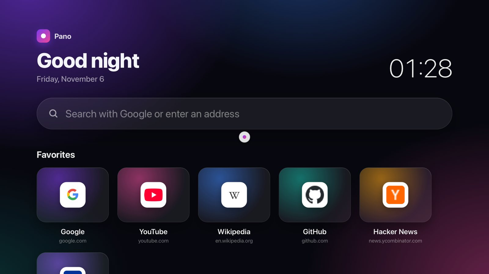
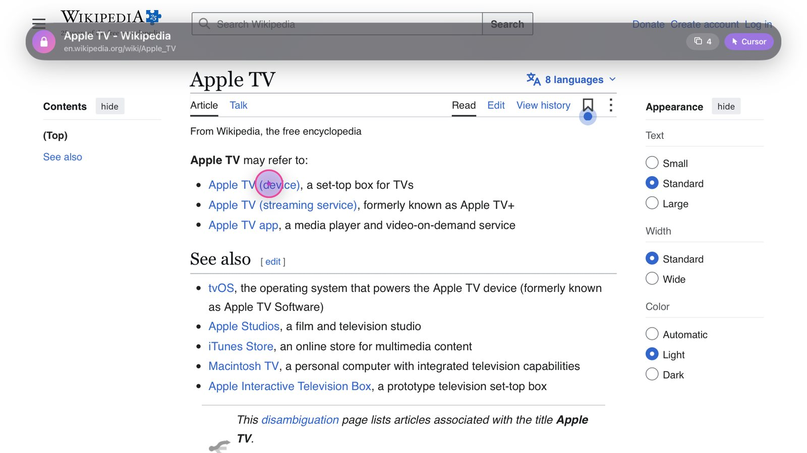
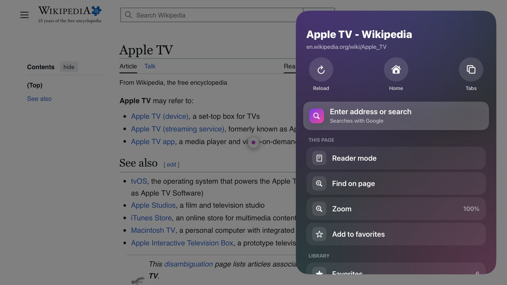
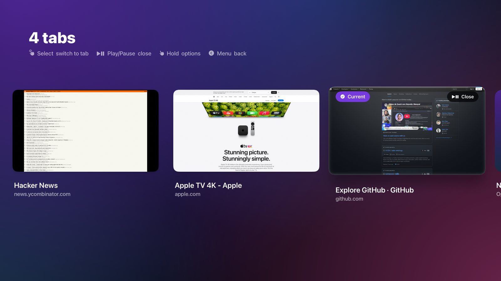
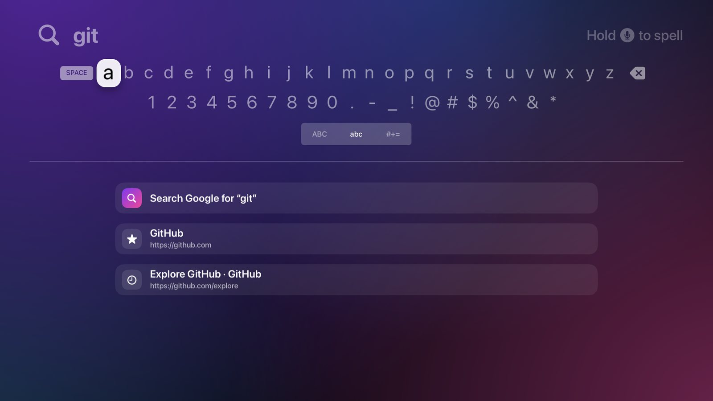
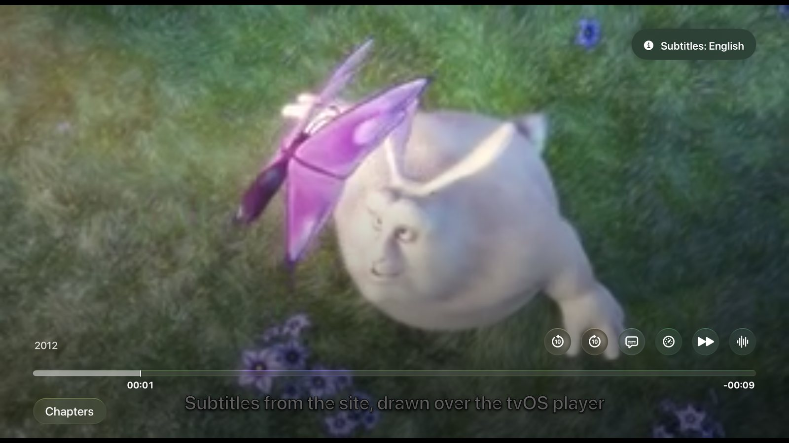

<p align="center">
  
</p>

<p align="center">
  <b>The web, on the biggest screen in your home.</b><br>
  A full web browser for Apple TV, built for the Siri Remote — with a real cursor, tabs,
  a native video player for web videos, subtitles, and your phone as a keyboard.
</p>

<p align="center">
  
  
  
  
</p>

---

<p align="center">
  
</p>

## Why Pano

Apple TV doesn't come with a web browser, and tvOS doesn't offer WebKit to apps. Pano brings the web to the TV
anyway, and designs every interaction around the remote you already hold: swipe to move a cursor, click to click,
and let the app handle the rest — typing, scrolling, video, subtitles and tabs.

## Highlights

<table>
  <tr>
    <td width="50%"></td>
    <td width="50%"></td>
  </tr>
  <tr>
    <td><b>A cursor that feels native.</b> An iPadOS-style pointer that turns into a ring and slows down over links.
      Smooth, eased scrolling; push the cursor to an edge to scroll. The top bar gets out of the way as you scroll down.</td>
    <td><b>Everything one button away.</b> Press Play/Pause for a glass side panel with quick actions, page tools,
      favorites, history, private browsing and settings.</td>
  </tr>
  <tr>
    <td></td>
    <td></td>
  </tr>
  <tr>
    <td><b>Tabs with live previews.</b> Up to eight tabs, restored when you come back. Play/Pause closes a tab,
      holding select shows more options.</td>
    <td><b>Search the tvOS way.</b> The native search keyboard with dictation and live suggestions from your
      favorites and history.</td>
  </tr>
  <tr>
    <td colspan="2"></td>
  </tr>
  <tr>
    <td colspan="2"><b>Web videos in the real Apple TV player.</b> Click a player on a page — even inside an embedded
      frame from another site — and Pano opens the video in the tvOS player, with the site's subtitles drawn on top.
      Resume where you left off, jump to the next episode, change speed, skip ±10 s, or search OpenSubtitles.</td>
  </tr>
</table>

## Features

**Browsing**
- Cursor and scroll modes, smart hover, smooth scrolling and edge scrolling
- Tabs with previews and session restore
- Favorites (rename, reorder, edit), history with search, private browsing
- Per-site zoom, text size, reader mode, find on page
- Desktop or mobile sites, choice of search engine
- Optional ad and tracker blocking

**Video**
- Opens web videos (MP4, HLS) in the native tvOS player with the right headers
- Collects the site's subtitles (`<track>`, WebVTT/SRT, including Windows-1254 SRT files); timing offset and appearance controls
- Resumes the same video where you left off; a **Continue watching** row on the home screen
- Next episode detection with an end-of-episode countdown, source/player picker
- Speed control, ±10 s buttons next to the timeline, skip intro
- OpenSubtitles search in your language (bring your own free API key)

**Phone control**
- Scan a QR code and use your phone as a keyboard, address bar and touch pad
- Runs on your local network only and is protected by a 6-digit PIN with lockout

**Design and languages**
- Dark glass design with a layered (parallax) app icon and Top Shelf image
- Localized into English, 简体中文, हिन्दी, Español, Français, العربية (right-to-left), Português (Brasil),
  Русский, Deutsch, 日本語 and Türkçe. It follows the system language, and you can override it in Settings.

## Remote

| Button | Action |
|---|---|
| Swipe on the touch surface | Move the cursor (push to an edge to scroll) |
| Click | Click; text fields open the search keyboard, players open the video full screen |
| **Play/Pause** | Open or close the menu |
| Hold Play/Pause | Tabs |
| Mode badge in the address bar | Switch between cursor and scroll mode (in scroll mode, a click returns to the cursor) |
| Arrow buttons | Scroll the page (◀ ▶ jump between matches when finding) |
| Menu / Back | Close find or reader mode → back → home → exit |

## Install

Pano uses a private API (see *How it works*), so it is **not on the App Store**. You build it and install it on
your own Apple TV with Xcode.

**Requirements:** a Mac with Xcode, [XcodeGen](https://github.com/yonaskolb/XcodeGen), an Apple TV on tvOS 17 or
later, and an Apple ID (a free one works).

1. Clone the repo and set your own team: change `DEVELOPMENT_TEAM` in `project.yml` (and the bundle identifier prefix
   if you like), then run `xcodegen generate`.
2. On the Apple TV, open Settings → Remotes and Devices → Remote App and Devices. On the Mac, pair it in
   Xcode → Window → Devices and Simulators. Both must be on the same network.
3. Open `Pano.xcodeproj`, choose your Apple TV as the destination and press **Run** (⌘R).

> With a free Apple ID, the app has to be reinstalled every 7 days; with a paid developer account, once a year.

## How it works

- **Engine.** tvOS has no public WebKit, but UIKit still contains `UIWebView` at runtime. Pano creates it with
  `NSClassFromString` and talks to it via selectors (`Pano/WebEngine.swift`). The real user agent is set on the inner
  WebKit1 `WebView`.
- **Frames.** The WebKit1 `WebFrame` API evaluates JavaScript inside cross-origin iframes. Pano uses it to forward
  clicks into embedded players and to find their videos and subtitles.
- **Video capture.** In-page playback is disabled. Pano notices that a page asked to play, or captures an `.m3u8` or
  `.mp4` requested over the network through a `URLProtocol`. It then hands the stream to `AVPlayerViewController`
  with the page's Referer and Origin headers.
- **Stability.** The legacy engine renders on its own thread. A layout guard (`Pano/LayoutGuard.swift`) defers
  off-main-thread layout of regular views, and media elements are sanitized to avoid known engine crashes.

### Limitations

- JavaScript runs without a JIT on the device, so script-heavy sites are slower than on a computer. *Mobile* site
  view helps.
- Videos that only play through Media Source Extensions (`blob:`) or DRM can't be opened in the native player.
- This is a personal, sideloaded app. It relies on private API and may stop working in a future tvOS release.

## Privacy

Pano has no accounts, analytics or servers. Everything stays on the Apple TV: favorites, history, sessions, watch
progress and settings. The phone remote is a small web page served by the Apple TV itself, on your local network only.

## Development

```
Pano/
  BrowserViewController*.swift  browser screen, remote input, menus, phone commands
  WebEngine.swift               runtime UIWebView bridge, frames, user agent
  Pages.swift                   home/error pages and injected scripts
  VideoPlayerController.swift   tvOS player + subtitles, resume, next episode
  MenuPanel.swift · TabSwitcherController.swift · SearchController.swift · Theme.swift
  Localizable.xcstrings         11 languages (English keys, use L("…") from Localization.swift)
scripts/make-icons.py           layered app icon and Top Shelf generator (Pillow)
```

Debug builds accept launch arguments for testing without a remote: `-openURL <url>`,
`-debugClickX/-debugClickY [-debugType <text>]` and `-debugAction <action> [-debugDelay <s>]`
(`menu`, `tabs`, `settings`, `search:<text>`, `opentabs:<url,url>`, `reader`, `find:<word>`, `zoom:<percent>`, `play`, …).

## License

Released under the [MIT License](LICENSE). Pano is not affiliated with Apple. Please respect the terms and the
content rights of the sites you visit.
